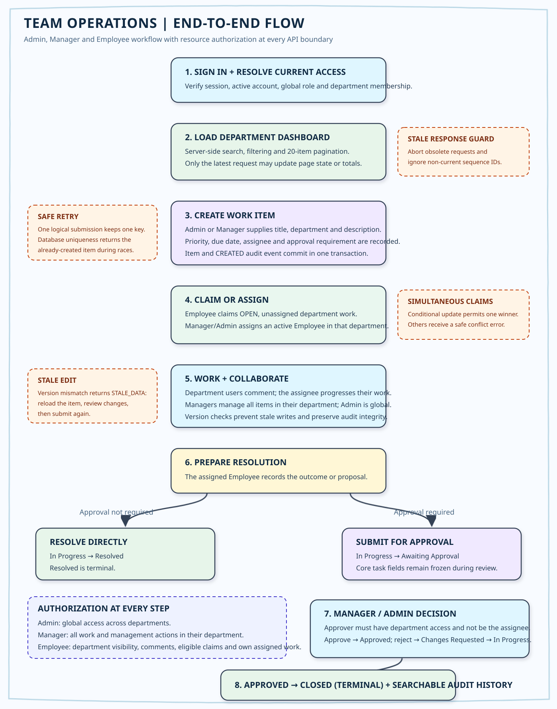
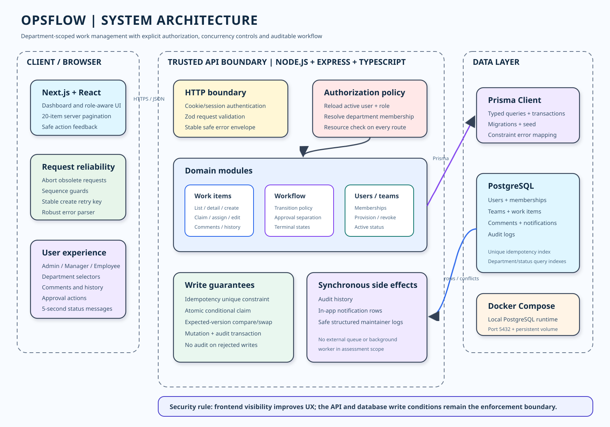

# OpsFlow - Operations Under Pressure

OpsFlow is a department-scoped operational work-management system built for the Newtonite Software Engineering Challenge. It emphasizes resource-level authorization, concurrency safety, idempotent creation, explicit workflow transitions, auditability, and recoverable user-facing errors.

## Product roles

- **Admin** has organization-wide visibility and management access across all departments.
- **Manager** can view and manage every work item in departments they manage.
- **Employee** can view and comment on work in their department, claim eligible open work, and update work assigned to them.

The backend enforces these rules for every protected resource. Frontend control visibility is only a usability feature and is never the authorization boundary.

## Operational flow

The following image is the project-aligned version of the original Excalidraw operational flow. It uses the final Admin, Manager and Employee role names and the implemented terminal-state workflow.



## System architecture



The editable Excalidraw source is available at [docs/diagrams/system-architecture.excalidraw](docs/diagrams/system-architecture.excalidraw).

### Architecture responsibilities

1. **Next.js frontend** renders the dashboard and work-item experience. It cancels obsolete list/detail requests and uses request sequence identifiers so late responses cannot overwrite current state. A logical create submission keeps one idempotency key across retries.
2. **Express TypeScript API** authenticates the session, reloads the active user and current database role, validates input with Zod, and enforces department access against the requested resource.
3. **Domain and workflow services** control claim, assignment, comments, approvals, status transitions, terminal states, and safe client-facing errors.
4. **Prisma transaction layer** performs conditional claims, expected-version compare-and-swap updates, idempotent creation, and mutation-plus-audit writes atomically.
5. **PostgreSQL** stores users, department memberships, work items, comments, notifications, and audit history. Unique constraints and indexes provide the final concurrency and integrity boundary.

In-app notification rows are written synchronously. An external delivery queue, email worker, push delivery, and background-job runtime are intentionally outside this assessment's scope.

## Technology stack

- Next.js 16, React and TypeScript frontend
- Node.js, Express and TypeScript API
- PostgreSQL 16 running through Docker Compose
- Prisma 7 ORM and migrations
- Zod request validation
- Node's built-in test runner with API-level integration tests

## Prerequisites

Install and start the following before running the project:

- Node.js 20.9 or newer
- npm
- Docker Desktop with Docker Compose v2
- Git, if the project is being cloned rather than opened locally

The commands below assume the repository is located at `D:\Project1_org_management`. Replace that path if the project is stored elsewhere.

## First-time installation

Open PowerShell at the repository root:

```powershell
cd D:\Project1_org_management

npm --prefix org_operations/backend install
npm --prefix org_operations/frontend install

Copy-Item org_operations/backend/.env.example org_operations/backend/.env
```

Before using the application outside local development, replace the example `JWT_SECRET` in `org_operations/backend/.env` with a long random secret. The supplied database URL matches the local Docker Compose service.

## Prepare the database

Start Docker Desktop, then run from the repository root:

```powershell
cd D:\Project1_org_management

npm run db:up
npm run db:generate
npm run db:migrate
npm run db:seed
```

The seed command creates the three departments and local demonstration accounts. It generates a unique cryptographically random password for every account, using longer passwords for higher-privilege accounts. Credentials are written to the git-ignored local file:

```text
org_operations/backend/.seed-credentials.local.json
```

The credential file is regenerated whenever `npm run db:seed` runs. It is for local demonstration only and must not be committed or used in production.

### View local demo credentials

After `npm run db:seed` completes, display the generated usernames and passwords with:

```powershell
cd D:\Project1_org_management
Get-Content org_operations/backend/.seed-credentials.local.json
```

The JSON lists every account's email, password, product role, and department. Use one Admin, Manager, or Employee record to sign in at `http://localhost:3000`.

`npm run db:seed` intentionally creates new passwords each time it runs. If you run it again, reread this local credential file before signing in. The file is git-ignored so passwords are never included in the submitted repository.

## Run the application

Use two PowerShell terminals and keep both running.

### Terminal 1 - backend

```powershell
cd D:\Project1_org_management
npm run dev:backend
```

The API starts at `http://localhost:4000`. Its health endpoint is:

```text
http://localhost:4000/health
```

### Terminal 2 - frontend

```powershell
cd D:\Project1_org_management
npm run dev:frontend
```

Open the application at:

```text
http://localhost:3000
```

Do not type PowerShell's `>>` continuation prompt as part of a command.

## Stop the database

After stopping the frontend and backend with `Ctrl+C`, the database container can be stopped with:

```powershell
cd D:\Project1_org_management
npm run db:down
```

## Verification

The PostgreSQL container must be running for the API integration tests.

```powershell
cd D:\Project1_org_management

npm test
npm run typecheck
npm run lint
npm run build
```

- `npm test` builds the backend and runs authorization, workflow, concurrency, idempotency and audit tests.
- `npm run typecheck` checks backend TypeScript without emitting files.
- `npm run lint` runs the frontend ESLint configuration.
- `npm run build` creates production builds for both backend and frontend.

## Workflow

Supported workflow transitions are:

- `Open -> In Progress` through an eligible Employee claim or Manager/Admin assignment.
- `Changes Requested -> In Progress` when work resumes.
- `In Progress -> Awaiting Approval` when assigned approval-required work is submitted.
- `Changes Requested -> Awaiting Approval` when corrected work is resubmitted.
- `Awaiting Approval -> Approved` by an eligible Manager/Admin who is not the assignee.
- `Awaiting Approval -> Changes Requested` when an eligible reviewer rejects with a reason.
- `Approved -> Closed` after approved work is completed.
- `In Progress -> Resolved` when approval is not required.

`Closed` and `Resolved` are terminal states. Invalid transitions and stale versions are rejected by the API.

## Main API routes

- `GET /api/teams` - departments available to the current user
- `GET /api/work-items?teamId=...` - paginated department search and filtering
- `POST /api/work-items` - idempotent creation using `Idempotency-Key`
- `GET /api/work-items/:id` - details, comments, activity and effective access
- `PATCH /api/work-items/:id` - versioned work-item edit
- `POST /api/work-items/:id/claim` - atomic eligible Employee claim
- `POST /api/work-items/:id/assign` - department assignment
- `POST /api/work-items/:id/comments` - add a department collaboration comment
- `POST /api/work-items/:id/request-approval` - submit assigned work for review
- `POST /api/work-items/:id/approve` - approve submitted work
- `POST /api/work-items/:id/request-changes` - reject with requested changes
- `POST /api/work-items/:id/resolve` - resolve work that does not require approval

## Further documentation

- [ENGINEERING_DECISIONS.md](ENGINEERING_DECISIONS.md) explains the five highest-risk design decisions in detail.
- [KNOWN_LIMITATIONS.md](KNOWN_LIMITATIONS.md) records genuine remaining limitations and production hardening work.
